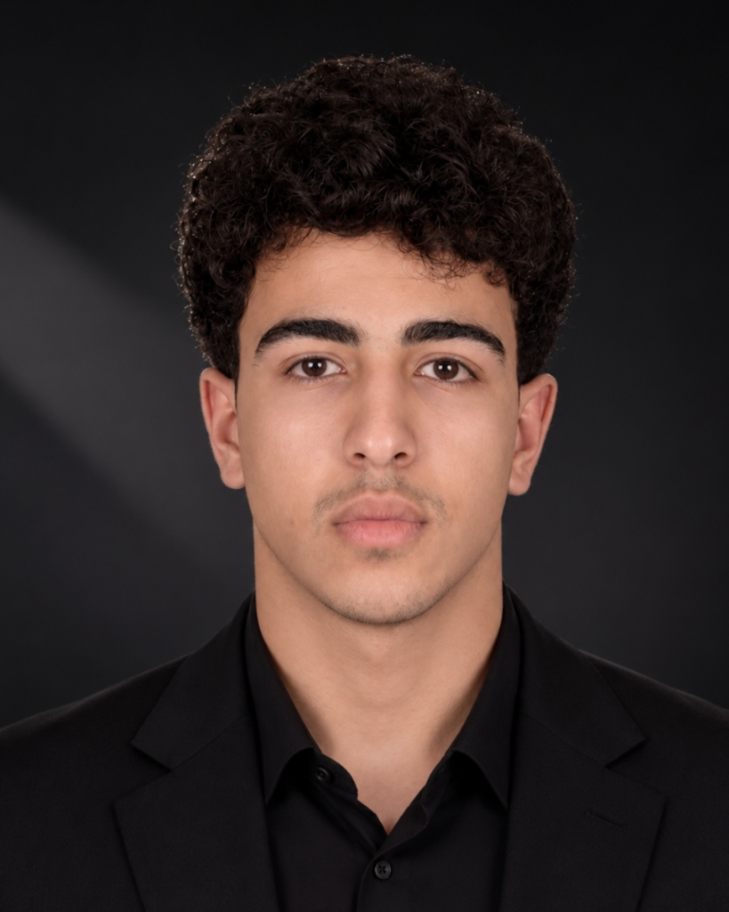

# Yousef Khalid — AI Automation & n8n Developer Portfolio

A timeless, luxurious, minimal single-page personal portfolio website for **Yousef Khalid**, AI Automation Engineer & n8n Developer.

- **Design Aesthetic:** Luxury Burgundy & Black (Sophisticated deep charcoal `#0B090A`, card background `#1B1518`, primary accent `#641E32`, secondary wine accent `#8B3049`, crisp typography `#F5F1F2`).
- **Tech Stack:** HTML5, CSS3, and Vanilla JavaScript (zero external dependencies, zero frameworks, no backend required).

---

## 📁 Project Structure

```text
Portfolio/
├── index.html                   # Single-page portfolio markup
├── README.md                    # Documentation & image replacement guide
├── css/
│   └── style.css                # Luxury Burgundy & Black styling & responsive rules
├── js/
│   └── script.js                # Theme toggle, mobile menu, scroll spy, modal deep-dives
└── assets/
    └── images/                  # High-resolution SVG placeholders & screenshot assets
        ├── portrait-placeholder.svg
        ├── project-01-workflow.svg
        ├── project-02-workflow.svg
        ├── project-03-workflow.svg
        ├── project-04-workflow.svg
        ├── project-05-workflow.svg
        ├── project-06-workflow.svg
        └── project-07-workflow.svg
```

---

## 🖼️ How to Replace Placeholder Images

### 1. Your Personal Portrait Photo
- **Target File:** `assets/images/yousef-portrait.jpg` (or `.png`)
- **Aspect Ratio:** Vertical **4:5** (Recommended resolution: `800 × 1000px` or `1200 × 1500px`).
- **Where to edit in `index.html`:**
  Find the comment:
  ```html
  <!-- ========================================================================= -->
  <!-- PORTRAIT IMAGE REPLACEMENT: Insert your real portrait photo below          -->
  <!-- ========================================================================= -->
  
  ```
  Change `src="assets/images/portrait-placeholder.svg"` to:
  ```html
  
  ```

---

### 2. Project n8n Workflow Screenshots
Each of the 7 projects showcases a dedicated, full-width **n8n Workflow Screenshot**:
- **Aspect Ratio:** Wide **16:9** (e.g., `1920 × 1080px`). Shows your complete n8n workflow canvas nodes, connectors, and execution logic.

#### Filenames for Each Project:
| Project | Target Filename (16:9 Aspect Ratio) |
|---|---|
| **01. Meta Ads Campaign Analysis & Reporting** | `assets/images/project-01-workflow.png` |
| **02. AI-Powered Lead Management & Follow-up** | `assets/images/project-02-workflow.png` |
| **03. Dental Clinic Support (IG & Messenger)** | `assets/images/project-03-workflow.png` |
| **04. Gym Customer Support & Booking (RAG)** | `assets/images/project-04-workflow.png` |
| **05. AI Invoice Data Extraction & OCR** | `assets/images/project-05-workflow.png` |
| **06. AI Product Photography & Ad Creative** | `assets/images/project-06-workflow.png` |
| **07. E-commerce Order Management & Carrier Sync** | `assets/images/project-07-workflow.png` |

> **Tip:** Simply place your PNG workflow screenshot into `assets/images/` using the exact `.png` filename, or overwrite the existing `.svg` file.

---

## 🎨 Luxury Burgundy & Black Palette Specifications

- **Main Background:** `#0B090A`
- **Secondary Background:** `#151113`
- **Card Background:** `#1B1518`
- **Card Hover:** `#24191E`
- **Primary Accent (Burgundy):** `#641E32`
- **Secondary Accent (Wine Red):** `#8B3049`
- **Primary Text:** `#F5F1F2`
- **Secondary Text:** `#A69A9E`
- **Borders:** `rgba(255, 255, 255, 0.08)`

---

## 🚀 How to View & Test Locally

You can open `index.html` directly in any web browser:
- Double click `index.html`, OR
- Right-click `index.html` → Open With → Google Chrome / Microsoft Edge / Brave.
